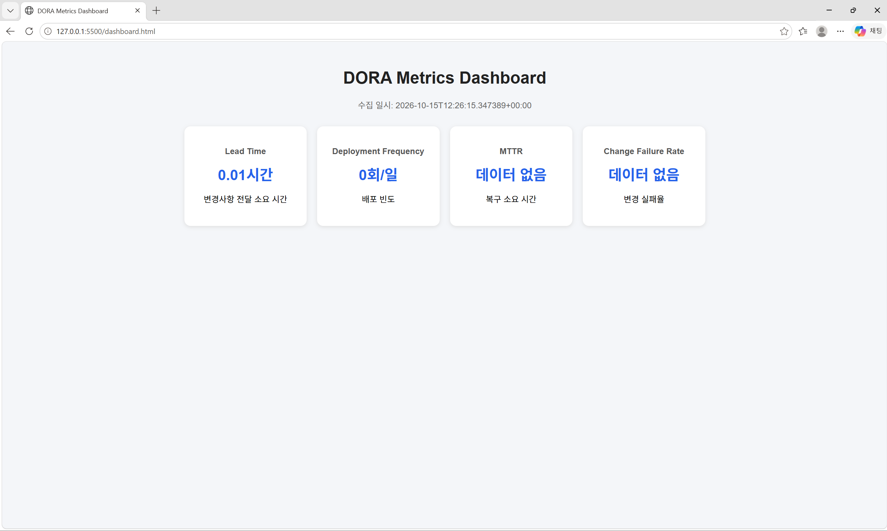

# ossljy

## 소개
Git과 GitHub 사용법을 연습하기 위한 저장소입니다.

## 학습 목표
- Git과 GitHub 사용법 익히기
- 커밋과 푸시 과정 이해하기
- 버전 관리 연습하기

## DORA Metrics 수집 테스트
GitHub Actions를 이용한 DORA Metrics 자동 수집을 테스트합니다.

## DORA Metrics Dashboard

GitHub Actions를 이용해 DORA 4대 지표를 자동으로 수집하고 대시보드로 확인합니다.

### 실행 결과

